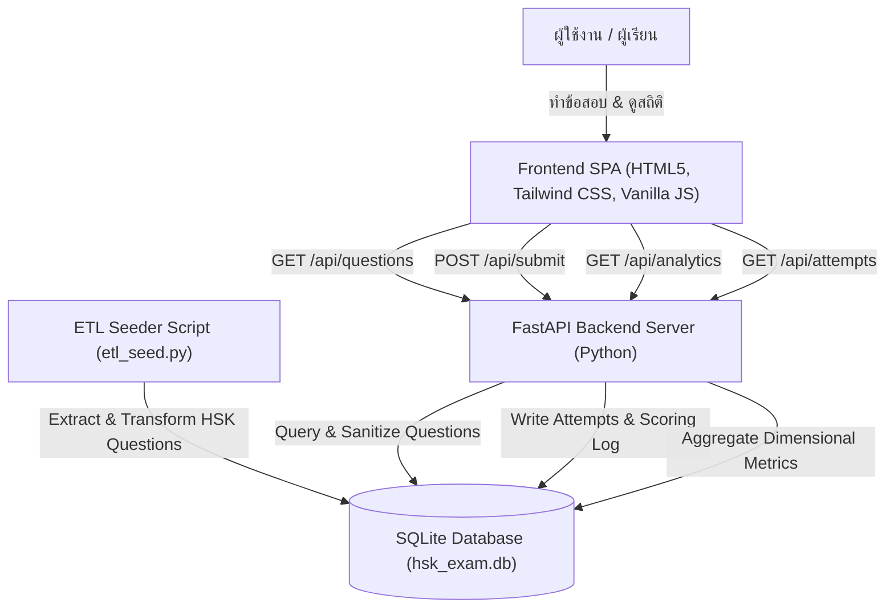

# 考 HSK Practice — Online Testing & Data Analytics Platform

ระบบเว็บฝึกทำข้อสอบภาษาจีน HSK ออนไลน์ พร้อมระบบจับเวลา ตรวจคะแนนทันที และ Data Pipeline สำหรับเก็บสถิติและวิเคราะห์ผลการสอบรายบุคคล (ออกแบบสำหรับการต่อยอดเป็น Portfolio สาย Data Engineering / Data Analytics)

แรงบันดาลใจและสไตล์การออกแบบจำลองแบบ Pixel-Perfect จาก [pixel-perfect-replay-45506.lovable.app](https://pixel-perfect-replay-45506.lovable.app) (สไตล์ Chinese Lacquer Cinnabar Red, กระดาษข้าวอุ่น, ตราประทับ 考 และฟอนต์ Noto Serif SC & Noto Sans Thai)

---

## 🌟 ฟีเจอร์หลักของระบบ (Core Features)

1. **ระบบจัดการข้อสอบ (Quiz & Test Engine)**
   - เลือกระดับข้อสอบได้ตั้งแต่ HSK 1, HSK 2, และ HSK 3
   - ดึงคำถามและตัวเลือก (Choices) มาสุ่มชุดข้อสอบ (Randomized Sampling) พร้อมจำแนกตามพาร์ท (คำศัพท์, ไวยากรณ์, ตัวเลขและเวลา, การอ่านและการสนทนา)
   - ซ่อนเฉลย (Security & Integrity) เพื่อป้องกันการตรวจคำตอบฝั่ง Client

2. **ระบบจับเวลาสอบจริง (Countdown Timer & Auto-Submit)**
   - นับเวลาถอยหลัง 3 นาที (180 วินาที) สำหรับข้อสอบ 8 ข้อ
   - ระบบเตือนสีแดงและ Pulse Effect เมื่อเวลาเหลือน้อยกว่า 30 วินาที
   - ส่งคำตอบและตรวจผลอัตโนมัติทันทีเมื่อหมดเวลา (Auto-submit on timeout)

3. **ระบบตรวจคะแนนและเฉลยละเอียด (Grading & Review Engine)**
   - คำนวณคะแนนและสัดส่วนเปอร์เซ็นต์ทันทีหลังส่งข้อสอบ
   - จำแนกผลคะแนนแยกตามแต่ละพาร์ท (Section Breakdown)
   - แสดงรายการข้อสอบทุกข้อ พร้อมเปรียบเทียบคำตอบของผู้ใช้กับเฉลยที่ถูกต้อง และคำอธิบายความรู้ภาษาจีนในแต่ละข้อ

4. **ระบบวิเคราะห์ข้อมูลความก้าวหน้า (Data Analytics & Dimensional Dashboard)**
   - สรุปภาพรวมสถิติ: จำนวนครั้งที่สอบทั้งหมด, คะแนนเฉลี่ย (%), คะแนนสูงสุด (%)
   - **Recent Scores Time Series Chart**: กราฟแท่งแสดงแนวโน้มคะแนน 12 ครั้งล่าสุด
   - **Section Accuracy Breakdown**: วิเคราะห์ความแม่นยำแยกตามมิติพาร์ทของข้อสอบ พร้อมแถบ Progress Bar
   - **Data-Driven Feedback**: ระบบแจ้งเตือนพาร์ทที่ทำคะแนนได้น้อยที่สุดเพื่อแนะนำแนวทางการพัฒนา

5. **ระบบประวัติการสอบ (Historical Tracking)**
   - บันทึกการสอบทุกครั้งลงฐานข้อมูล SQLite แบบ Relational
   - ตารางแสดงประวัติพร้อมระบุ วันที่-เวลา, ระดับ HSK, คะแนนที่ได้, อัตราส่วนร้อยละ, และเวลาที่ใช้ทำข้อสอบจริง

---

## 🏗️ สถาปัตยกรรมข้อมูลและเทคโนโลยี (Tech Stack & Architecture)



### 1. Data Schema Design
- **Table `questions` (Dimension Table)**:
  - `id`: Primary Key
  - `level`: ระดับ HSK (1, 2, 3)
  - `part`: มิติพาร์ทข้อสอบ (คำศัพท์, ไวยากรณ์, ตัวเลขและเวลา, การอ่านและการสนทนา)
  - `question`: คำถามภาษาจีน
  - `pinyin`: คำอ่านพินอิน
  - `translation`: คำแปลภาษาไทย
  - `options`: ตัวเลือกในรูปแบบ JSON Array `["A", "B", "C", "D"]`
  - `correct_answer`: คำตอบที่ถูกต้อง
  - `explanation`: คำอธิบายประกอบเฉลย
- **Table `exam_attempts` (Fact / Analytics Table)**:
  - `id`: Primary Key
  - `user_id`: รหัสผู้ใช้
  - `level`: ระดับ HSK ที่สอบ
  - `score`: คะแนนที่ได้
  - `total`: จำนวนข้อสอบทั้งหมด
  - `percentage`: คะแนนคิดเป็นเปอร์เซ็นต์
  - `time_spent_seconds`: ระยะเวลาที่ใช้ทำข้อสอบจริง (วินาที)
  - `parts`: JSON Object สรุปผลรายพาร์ท เช่น `{"คำศัพท์": [3, 4], "ไวยากรณ์": [2, 2]}`
  - `answers_detail`: JSON Array บันทึกรายละเอียดการตอบทุกข้อ
  - `created_at`: เวลาที่ทำข้อสอบ (Timestamp)

---

## 🚀 วิธีการติดตั้งและรันระบบ (Setup & Running)

### 1. ติดตั้ง Dependencies
```bash
pip install -r requirements.txt
```

### 2. รัน ETL เพื่อสร้าง Database และโหลดคลังข้อสอบ HSK
```bash
python -m app.etl_seed
```

### 3. รันเซิร์ฟเวอร์ Backend & Frontend
```bash
python run_server.py
```
หรือรันผ่าน Uvicorn โดยตรง:
```bash
uvicorn main:app --host 127.0.0.1 --port 8000 --reload
```

### 4. เปิดเบราว์เซอร์ใช้งาน
เปิดเบราว์เซอร์แล้วเข้าไปที่:
👉 **[http://127.0.0.1:8000](http://127.0.0.1:8000)**

---

## 🧪 การทดสอบระบบอัตโนมัติ (Automated Testing)
รันชุดทดสอบ API Contracts, Security Invariants, และ Analytics ด้วย Pytest:
```bash
python -m pytest tests/test_app.py -v
```
ผลลัพธ์ผ่านการทดสอบ 100% ครอบคลุม:
- `test_health`: ตรวจสอบความพร้อมของเซิร์ฟเวอร์
- `test_get_questions_security`: ตรวจสอบการตัดเฉลยออกจาก Payload หน้าบ้าน
- `test_get_questions_by_level`: ทดสอบการกรองตามระดับ HSK
- `test_submit_exam_and_grading`: ทดสอบระบบตรวจข้อสอบและคำนวณคะแนน
- `test_attempts_history_endpoint`: ทดสอบการดึงประวัติการสอบ
- `test_analytics_aggregation`: ทดสอบการคำนวณสถิติความก้าวหน้าและการวิเคราะห์จุดอ่อน
